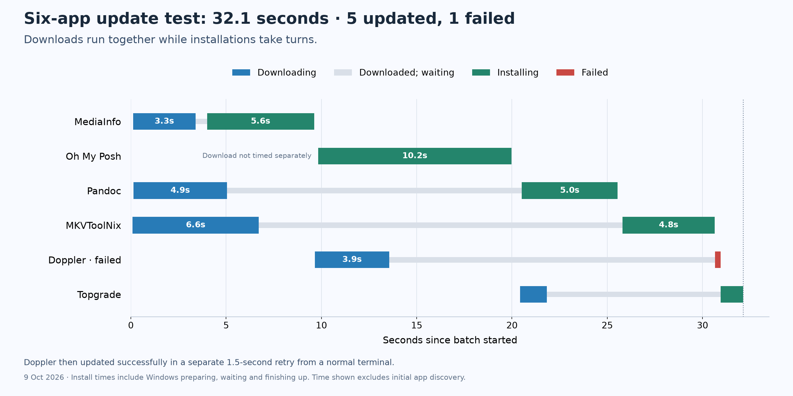

# Live upgrade validation notes

## First elevated batch

On 2026-10-09 local time, the app completed an elevated three-package batch with `Microsoft.WindowsPackageManager.ComInterop` 1.30.100-preview against installed WinGet 1.30.110-preview on Windows 10.0.26220.9606. The batch used four in-flight slots; all three selected upgrades returned `Ok`. The recorded batch time was 30.1229 seconds, and the surrounding process took 32.5027 seconds. This was a functional live run, not a controlled performance comparison, so it does not establish a speedup over another updater.

WinGet's diagnostics logged the Delivery Optimization transfer boundaries. All three downloads were active together for most of the transfer window:

| Package | Transfer start to completion (local time) | Transfer duration |
| --- | --- | ---: |
| Notepad++ | 22:06:12.669–22:06:16.686 | 4.017 s |
| lazygit | 22:06:12.649–22:06:16.953 | 4.304 s |
| MediaInfo | 22:06:12.686–22:06:16.110 | 3.424 s |

The API reported a maximum of three `Downloading` states and one `Installing` state, with 3.300 seconds of downloading/installing state overlap. That 3.300 seconds is not a measurement of simultaneous network transfer and installer execution. The payloads finished at 22:06:16.110–16.953, while the corresponding API `Downloading` intervals ended at 16.148 for MediaInfo, 17.831 for lazygit, and 19.742 for Notepad++. In particular, Notepad++ remained in `Downloading` for about 3.056 seconds after its transfer had completed, while WinGet worked through earlier package installs. Its native installer did not start until 22:06:19.744, after all payload downloads were complete.

MediaInfo's install command began at 22:06:16.141, while the lazygit and Notepad++ transfers continued until 16.953 and 16.686. Thus about 0.812 seconds of payload transfer overlapped the first install work. The later 1.658-second API overlap between lazygit's `Installing` and Notepad++'s `Downloading` states occurred after Notepad++'s bytes were already downloaded. Treat the API overlap as a phase-state metric; use the COM diagnostic `Download completed` entries when discussing actual transfer timing.

Evidence is in `artifacts/runs/first-live-batch/events.jsonl` and `results.json`, plus `artifacts/live-test/diagnostics/WinGetCOM-2026-10-09-22-06-10.484.log` and the three per-package logs timestamped `22-06-12.624`, `22-06-12.654`, and `22-06-12.669`.

## Six-package elevated batch

On 2026-10-09 local time, the elevated six-package run completed in 32.126 seconds. Five upgrades returned `Ok`; Doppler returned `InternalError` (`0x8A15007D`, logged in `UninstallFlow`). A separate normal-context Doppler retry then returned `Ok` in 1.526 seconds. Across this batch, that retry, and the first three-package batch, all nine selected apps were verified. This was a functional live run, not a controlled performance comparison.

The API reported at most four `Downloading` states and one `Installing` state, with 25.165 seconds of `Downloading`/`Installing` overlap. That is overlap between API phases, not a measurement of network traffic overlapping native installer execution. WinGet diagnostics provide explicit Delivery Optimization boundaries for five packages:

| Package | Logged transfer (local time) | Transfer | API `Downloading` continued after transfer |
| --- | --- | ---: | ---: |
| MKVToolNix | 22:08:03.271–22:08:09.889 | 6.618 s | 19.087 s |
| MediaInfo | 22:08:03.297–22:08:06.575 | 3.278 s | 0.600 s |
| Pandoc | 22:08:03.315–22:08:08.227 | 4.912 s | 15.469 s |
| Doppler | 22:08:12.830–22:08:16.743 | 3.913 s | 17.087 s |
| topgrade | 22:08:23.612–22:08:25.005 | 1.393 s | 9.124 s |

Oh My Posh has no Delivery Optimization marker in its diagnostic. Its log instead records a 9.411-second `StagePackageAsync` operation for the MSIX, followed by package registration. The simplified chart includes this work in its installing bar; its download was not timed separately. Summing intersections between each logged transfer and other packages' API `Installing` intervals gives 8.816 package-pair seconds: MKVToolNix and Pandoc transfers overlapped MediaInfo's API `Installing` phase, Doppler's transfer overlapped Oh My Posh's, and topgrade's transfer overlapped Pandoc's. The API `Installing` phase includes preparation and waiting, so these intersections do not establish that downloads overlapped vendor installer execution.

The chart uses blue for logged downloads, thin gray bars for downloaded packages waiting, green for installation including preparation and finishing, and red for a failed attempt. Rows follow installation order. The time shown starts after app discovery and excludes the separate Doppler retry.

Rebuild the derived timings and detailed diagnostic chart with `uv run --no-project --offline --with matplotlib python artifacts/analysis/analyze_larger_live_batch.py`, then render the simplified chart above with `uv run --no-project --offline --with matplotlib python docs/render_live_timeline.py`. These scripts require the locally retained measurements. They do not modify the raw run artifacts. Evidence is in `artifacts/runs/larger-live-batch/` and `artifacts/larger-live-test/diagnostics/`, with the separate Doppler retry in `artifacts/runs/doppler-user-retry/`.
